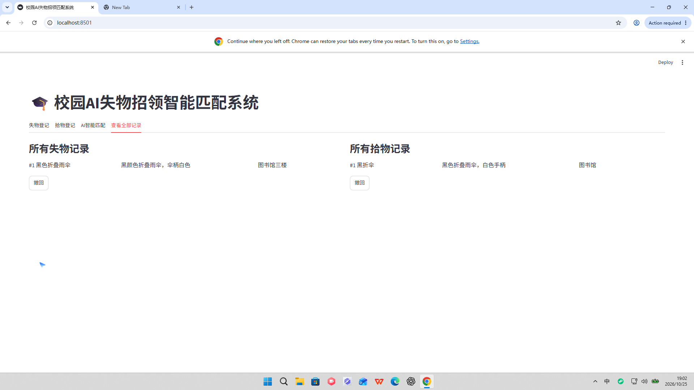

# 🎓 校园AI失物招领智能匹配系统

基于 **Streamlit + SQLite + 智谱AI（文本 Embedding + 视觉 GLM-4V）** 的校园失物招领智能匹配演示项目。
用户登记失物/拾物信息后，系统自动用语义向量计算相似度，把失主与拾物记录智能配对；支持上传物品照片，AI 自动识别外观特征辅助匹配。


## ✨ 功能

- 📥 失物登记 / 📤 拾物登记：物品名、描述、地点、时间、联系方式
- 🖼️ **图片识别**：上传物品照片，智谱 GLM-4V 自动识别外观特征并纳入匹配
- 🤖 AI 语义匹配：`embedding-2` 文本向量 + 余弦相似度，阈值可调
- 🗑️ 记录撤回：带二次确认，防止误删
- 💾 SQLite 本地数据库，零配置启动

| 登记页 | 记录与撤回 | AI 匹配 |
|---|---|---|
|  |  |  |

## 🛠 技术栈

| 模块 | 技术 |
|---|---|
| 网页界面 | Streamlit |
| 数据库 | SQLite（Python 内置） |
| 文本向量 | 智谱 `embedding-2` |
| 图片识别 | 智谱 `glm-4v-plus` 多模态视觉模型 |
| 相似度计算 | NumPy 余弦相似度 |

## 🚀 本地运行

1. 安装依赖（Python 3.8+）：

```bash
pip install -r requirements.txt
```

2. 复制配置模板并填入你的智谱 API Key（[智谱开放平台](https://open.bigmodel.cn) 免费获取）：

```bash
cp config.example.py config.py
# 编辑 config.py，填入你的 API_KEY
```

3. 启动：

```bash
streamlit run app.py
```

浏览器自动打开 http://localhost:8501 即可使用。

## ☁️ 一键部署到 Streamlit Community Cloud（免费永久在线）

1. 把本仓库推到你的 GitHub
2. 打开 <https://share.streamlit.io>，用 GitHub 登录
3. 选择本仓库，主文件指定 `app.py`
4. 在 Settings → Secrets 里填入：

```toml
ZHIPUAI_API_KEY = "你的智谱API_KEY"
```

5. 点击 Deploy，等待几分钟即可获得永久访问地址

> 云端环境通过环境变量 `ZHIPUAI_API_KEY` 读取 Key，无需提交 `config.py`（已在 .gitignore 中排除）。

## 📁 项目结构

```
├── app.py              # Streamlit 网页主程序（登记/匹配/记录/撤回）
├── database.py         # SQLite 建表、增删查（含图片字段自动迁移）
├── matching.py         # embedding 向量 + 余弦相似度 + GLM-4V 图片识别
├── config.example.py   # API Key 配置模板
├── config.py           # 本地配置（已被 .gitignore 排除，勿提交）
├── requirements.txt    # 依赖清单
└── docs/               # 界面截图
```

## 🧪 测试用例

| 失物 | 拾物 |
|---|---|
| 黑色折叠雨伞 / 黑颜色折叠雨伞，伞柄白色 / 图书馆三楼 | 黑折伞 / 黑色折叠雨伞，白色手柄 / 图书馆 |

两组描述的向量相似度约 **0.86**，超过 0.7 阈值即可被匹配成功。

## 📄 License

[MIT](LICENSE)
